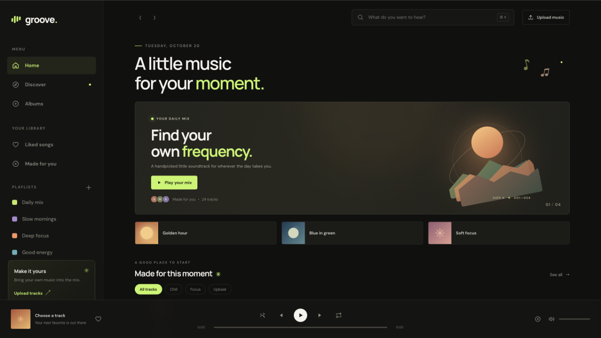

# groove music player



A full-stack JavaScript music player. The browser UI is served by a Node.js backend that provides the track library, persists favorites and uploaded-track metadata, and streams uploaded audio with byte-range support.

## Run locally

Requires Node.js 20 or later. No package installation is needed.

```sh
npm start
```

Open [http://127.0.0.1:3000](http://127.0.0.1:3000). For automatic server restarts while developing, run `npm run dev`.

Uploaded audio files are stored in `uploads/`; the library and favorite state are stored in `data/tracks.json`. Those files are created when the server starts. Uploads are limited to 60 MB per request and supported audio file extensions are MP3, M4A, AAC, WAV, OGG, Opus, FLAC, and WebM.

## API

- `GET /api/tracks` — list tracks
- `POST /api/tracks` — upload one or more audio files using multipart field `songs`
- `PATCH /api/tracks/:id/like` — toggle a track's favorite state
- `GET /uploads/:filename` — stream an uploaded track (supports HTTP byte ranges)
